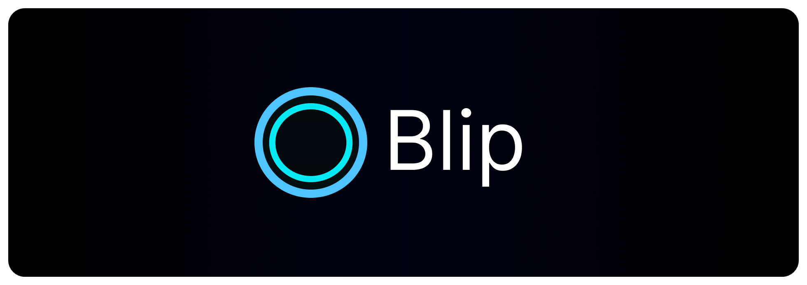

<h1 id="start-of-content" align="center">
  
</h1>

<strong>🔘 A lightweight tool that adds smooth blip effects to your clicks.</strong>

<a href="#-installation">📦 Installation</a> •
<a href="#-features">⭐ Features</a> •
<a href="#-showcase">📸 Showcase</a>

## 📦 Installation

### 1. Download `🔘 Blip`
Get it from the [Releases Page](https://github.com/QuintixLabs/Blip/releases/latest).

### 2. Set it up
Run it, and the welcome screen lets you pick a shape and a color before you start.

## ⭐ Features

- 🔘 A soft blip wherever you click, so your clicks are easy to see
- 🖱️ Left, right and middle click, each with its own color and on/off switch
- 🎨 Pick the shape (circle, ring, square, hexagon, diamond) and any color
- 📏 Set the size, opacity, speed and when it fades
- 🛡️ You choose where blips show
- 🚫 Skip any app or game you pick, and blips won't show there
- 🌗 Light, dark, or the same as your system
- 🪶 Low on resources since it's a Tauri app
- *And much more...!*

## 📸 Showcase

https://github.com/user-attachments/assets/6206bbc4-8847-4bac-a029-8006b49d5b3d

## 📄 License

Blip is [Free Software](https://en.wikipedia.org/wiki/Free_software): You can use, study, share and modify it at your will. The app can be redistributed and/or modified under the terms of the
[GNU General Public License version 3](https://www.gnu.org/licenses/gpl.html) published by the
[Free Software Foundation](https://www.fsf.org/).

<table><td>
<a href="#start-of-content">↥ Scroll to top</a>
</td></table>

